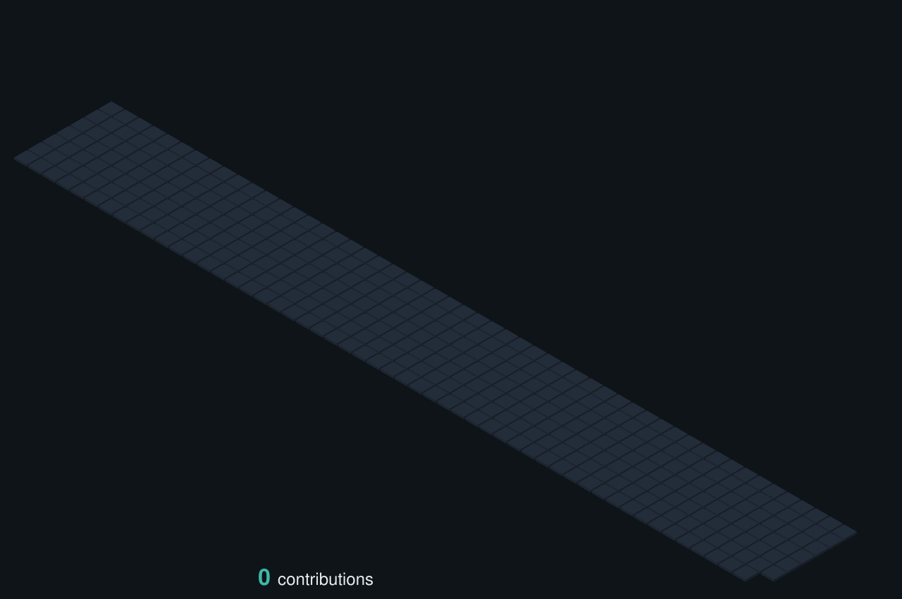

<!-- eunseoxz profile README v2 draft. Animated SVGs live in assets/ (no scripts, no external URLs). -->

  

### Hi, I'm Eunseo.

I build small, sharp tools where AI agents meet onchain rails: identity, payments, and the boring plumbing that makes agents trustworthy.

  

<b><a href="https://github.com/eunseoxz/opendesk">OpenDesk</a></b>: a helpdesk for AI agents on BNB Chain. Agents verify with Binance Agent ID, open tickets, and settle on-chain. 
<a href="https://opendesk-dc5.pages.dev/?demo=ready">Live demo</a>&nbsp;&nbsp;&nbsp;&nbsp;<a href="https://bscscan.com/address/0x92D3290E4bB04E32D321d58A5bB1a77E049F2e93#code">Verified contract</a>

  

  

<i>Ship the smallest thing that works, verify it in public, then make it better.</i>

<!-- 3d city: add when contributions > 0 -->
<!-- 

 -->
